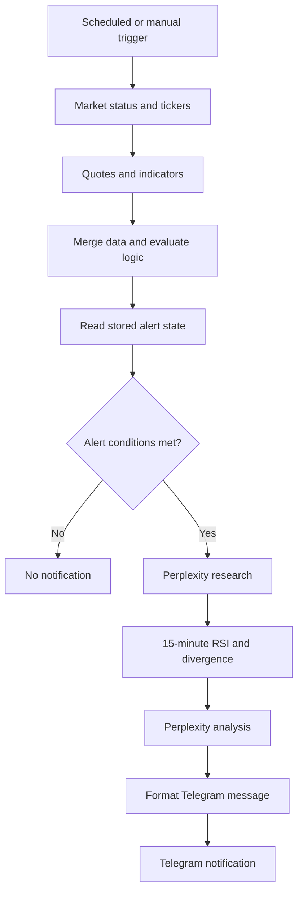

# System Architecture

## Overview
The exported n8n workflow has **49 nodes**. This includes the main monitoring path, alternate test paths, and debugging nodes. A structural overview is provided in `workflow/workflow-structure.json`.

## Major components
- **Orchestration:** n8n manual and schedule triggers; the schedule node is configured for a one-minute interval in the export.
- **Market data:** HTTP requests for market status, quotes, Yahoo indicators, and 15-minute RSI source data.
- **Data processing:** JavaScript code nodes for parsing, merging, screening, RSI, divergence, and message formatting.
- **State:** n8n Data Table operations (`Get row(s)`, `Upsert row(s)`) support persistence and evaluation of alerts.
- **AI-assisted research:** separate Perplexity research and analysis HTTP requests.
- **Notification:** Telegram message node.

## Important implementation boundaries
- The diagram is a **simplified conceptual view**, not an exact reproduction of all node connections or execution branches.
- The source includes several `TEST` and `DEBUG` nodes; their presence does not establish automated test coverage.
- Export metadata shows `active: false`; live activation and end-to-end behavior have not been independently verified.
- Credential references and runnable code have been intentionally excluded from the public structural export.
