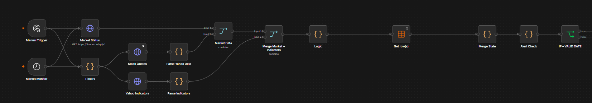

# AI-Powered Stock Market Assistant

**Product portfolio case study | n8n · market data APIs · Perplexity AI · Telegram**

A personal, experimental stock-market research and alerting workflow. This repository demonstrates how I translate a problem into product requirements, orchestrate data and AI-assisted analysis, and structure a system for iterative improvement.

> **Scope and transparency:** The source is an exported n8n workflow. The export contains 49 nodes, including test/debug nodes. The exported workflow is marked `active: false`; this repository does **not** claim verified live production operation or independently validated investment performance. No trading execution is shown in the workflow.

## The problem

Monitoring several securities requires collecting prices, checking market conditions, comparing indicators, researching context, and deciding when an alert is worth attention. Repeating those steps manually is time-consuming and inconsistent.

## Product approach

- **Automate collection:** market status, stock quotes, and Yahoo market indicators.
- **Apply deterministic logic:** evaluate market data, state, and alert conditions before escalating.
- **Enrich selectively:** request AI-supported research and analysis for candidates that pass workflow gates.
- **Keep a human in control:** deliver a research-oriented Telegram notification; the investor makes the decision.
- **Iterate:** use test and debug nodes to examine edge cases and refine alert logic.

## Product decisions & trade-offs

The design choices below explain the product rationale behind the workflow. They are interpretations of the documented architecture, not claims of measured performance or a formal decision log.

| Decision | Rationale | Trade-off |
|---|---|---|
| **Use n8n for orchestration** | Make integrations, execution order, and iteration visible in a single workflow rather than building a custom orchestration service from scratch. | Faster prototyping and easier inspection, but growing node complexity can make versioning, testing, and maintenance harder. |
| **Screen with rules before AI enrichment** | Use market data, indicators, and stored alert state to decide which cases warrant deeper research. | Reduces unnecessary AI calls and separates numerical conditions from interpretation, but rigid thresholds can miss relevant market context. |
| **Separate research from interpretation** | Use distinct Perplexity requests for gathering context and analysing a candidate alongside technical signals. | Clearer responsibilities and easier inspection, at the cost of extra latency, API usage, and potential propagation of AI errors. |
| **Keep investment decisions human-led** | Deliver research-oriented Telegram alerts instead of placing orders automatically. | Preserves human judgment and limits automation risk, but requires attention and can delay action. |
| **Maintain state between runs** | Use n8n Data Tables to support alert checks across monitoring cycles. | Enables state-aware behaviour, but introduces consistency, duplication, and recovery cases that require testing. |

**How I would evaluate these choices:** monitor duplicate-alert rate, source-data freshness, workflow completion time, AI output traceability, and the usefulness of alerts to the end user. These are proposed success measures; the repository does not claim verified results.

## Workflow at a glance

1. Scheduled or manual trigger initiates a market-monitoring cycle.
2. Market status and configured tickers are read; quotes and indicators are fetched.
3. Data are merged, evaluated, and checked against stored alert state.
4. Qualifying cases move through research, 15-minute RSI/divergence calculations, and AI analysis.
5. Results are formatted for Telegram notification.

See [architecture](ARCHITECTURE.md), [product requirements](PRODUCT_REQUIREMENTS.md), [agent design](AGENT_DESIGN.md), and [validation](VALIDATION_AND_SAFETY.md).

## Portfolio artefacts

| Artefact | Purpose |
|---|---|
| [Product requirements](PRODUCT_REQUIREMENTS.md) | Problem, users, scope, acceptance criteria |
| [Architecture](ARCHITECTURE.md) | System boundaries and data flow |
| [AI-assisted analysis](AGENT_DESIGN.md) | Research and analysis responsibilities |
| [Validation and safety](VALIDATION_AND_SAFETY.md) | Data quality, human oversight, testing |
| [Roadmap](ROADMAP.md) | Current evidence vs proposed improvements |
| [Workflow structure](workflow-structure.json) | Safe, non-importable structural overview of nodes and connections |

## Privacy and reproducibility

This public portfolio intentionally excludes the original importable workflow, executable code-node content, credentials, account identifiers, webhook URLs, private portfolio positions, and personal messaging destinations. The included JSON is a **structural representation, not an importable n8n workflow**.

## Disclaimer

This is a product/engineering portfolio project, **not investment advice**. AI output can be inaccurate, delayed, or incomplete; investment decisions require independent verification.
